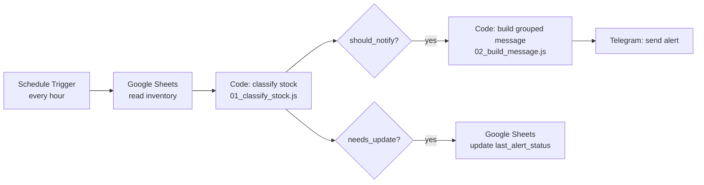

# Inventory Alerts Automation (n8n)

A workflow that watches a retail inventory sheet and sends **one grouped alert** to Telegram when products run low, instead of making someone check stock by hand. It is built around three production concerns that simple "if stock < X, send message" automations usually ignore:

- **No alert spam.** A product that stays low does not trigger a new message every run; only a *worsening* status does.
- **Bad data is never swallowed.** Blank or non-numeric stock values are reported as data issues instead of being silently treated as zero.
- **The decision logic is tested.** The JavaScript inside the n8n Code nodes lives in this repo and has 15 automated tests.

## How it works



1. On a schedule, n8n reads every row of the inventory sheet.
2. A Code node classifies each product and decides whether to notify and whether to update the sheet.
3. Rows that need an alert are merged into **a single message**, grouped by urgency, and sent to Telegram.
4. The sheet's `last_alert_status` column is updated so the same situation is not alerted again.

## Alert rules

| Status | Condition |
|---|---|
| `OUT` | stock = 0 |
| `CRITICAL` | stock ≤ 50% of the reorder point |
| `LOW` | stock ≤ reorder point |
| `OK` | stock above the reorder point |
| `DATA_ERROR` | stock is blank, non-numeric or negative, or the reorder point is missing or ≤ 0 |

**When is a notification sent?** Only when severity *increases* compared with `last_alert_status` (`OK → LOW → CRITICAL → OUT`), or when a row *newly* becomes a data error.

| Situation | Notify | Update sheet |
|---|---|---|
| New problem (was OK) | yes | yes |
| Same status as last run | no | no |
| Escalation (e.g. LOW → CRITICAL) | yes | yes |
| De-escalation (e.g. OUT → LOW) | no | yes |
| Back to OK | no | yes (clears the state) |
| Data error, already reported | no | no |

## Data format

The workflow expects a sheet with these columns (see `data/inventory_sample.csv`):

`sku, product_name, category, stock, reorder_point, supplier, last_alert_status`

`last_alert_status` is written by the workflow; leave it empty when you start. The sample file contains fictional products, including two deliberately broken rows (blank and `n/a` stock) to show the data-issue handling.

## Example alert

Output produced by the Code nodes on the sample data:

```
📦 Inventory alert: 7 item(s) need attention

🔴 OUT OF STOCK — 1
• SKU-006 Canvas Backpack — stock 0 (reorder at 15) · Cuero Andino

🟠 CRITICAL (at or below 50% of reorder point) — 4
• SKU-004 Summer Dress — stock 12 (reorder at 30) · Moda Sur
• SKU-008 Wool Scarf — stock 9 (reorder at 20) · Textiles Norte
• SKU-014 Underwear (5-pack) — stock 5 (reorder at 60) · Textiles Norte
• SKU-022 Scented Candle — stock 3 (reorder at 18) · Hogar Plus

⚠️ DATA ISSUES (fix them in the sheet) — 2
• SKU-017 Water Bottle — invalid stock: ""
• SKU-019 Resistance Bands — invalid stock: "n/a"
```

## Setup

1. **Sheet:** import `data/inventory_sample.csv` into a new Google Sheet.
2. **Telegram bot:** create one with [@BotFather](https://t.me/BotFather), keep the token, send your bot a message, and find your chat ID.
3. **n8n:** use n8n Cloud or self-host it (see the [n8n docs](https://docs.n8n.io)). Add credentials for Google Sheets and Telegram **inside n8n**.
4. **Build the workflow** with the nodes in the diagram above. Paste `n8n/01_classify_stock.js` and `n8n/02_build_message.js` into the two Code nodes (mode: *Run Once for All Items*).

| Node | Key settings |
|---|---|
| Schedule Trigger | every 1 hour |
| Google Sheets (read) | operation *Get Row(s)*, no filters |
| Code 1 | `01_classify_stock.js` |
| Filter / IF (notify) | `{{ $json.should_notify }}` is true |
| Code 2 | `02_build_message.js` |
| Telegram | text: `{{ $json.message }}` |
| Filter / IF (update) | `{{ $json.needs_update }}` is true |
| Google Sheets (update) | match on `sku`; set `last_alert_status` to `{{ $json.status === 'OK' ? '' : $json.status }}` |

**Secrets:** tokens and OAuth credentials live in n8n's credential store, never in this repository. If you export the workflow JSON, review it before committing.

## Tests

The scripts in `n8n/` are exactly what gets pasted into n8n. The tests load those same files and run them against a fake n8n input:

```bash
node --test        # tested on Node 22
```

They cover the status thresholds (including the exact boundaries), values arriving as text or with spaces, blank/invalid data, escalation vs de-escalation vs recovery, idempotency (a second run after the sheet is updated produces zero alerts), the grouped message layout, and Telegram's 4096-character limit.

## Design decisions and limitations

- **Sheet as state store.** `last_alert_status` keeps the workflow simple and visible to non-technical users, but Google Sheets is not a database; for high volume a real database would be a better fit.
- **Polling, not events.** The workflow checks on a schedule; it does not react the instant stock changes.
- **Notify and update run as parallel branches.** If Telegram fails after the sheet is updated, that alert would be lost. A stricter version would update the sheet only after a successful send, and a separate error workflow (Error Trigger) should notify on failures.
- **Thresholds are simple.** A fixed reorder point per product ignores demand and supplier lead time; a natural next step is alerting on estimated days of cover.

## Project structure

```
inventory-alerts-n8n/
├── n8n/
│   ├── 01_classify_stock.js   # status + notify/update decision
│   └── 02_build_message.js    # grouped alert message
├── data/inventory_sample.csv  # fictional inventory (includes bad rows)
├── tests/logic.test.js        # 15 tests (node --test)
└── docs/screenshots/          # screenshots of the workflow in n8n
```

<!-- After building the workflow in n8n, add a screenshot to docs/screenshots/ and show it here:

-->
